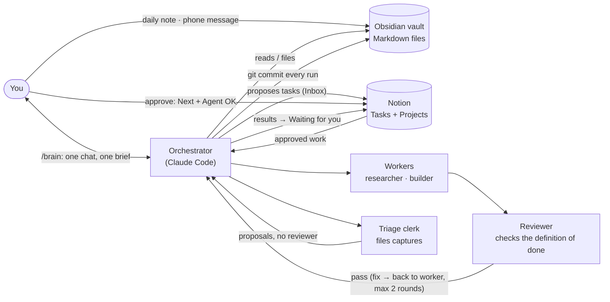

# Second Brain pack: Obsidian + Claude Code + Notion

A ready-made second brain you run with one command. You write your thoughts in Obsidian, Claude Code files them and turns real intentions into Notion tasks, you approve the ones you want done, and agents do them and hand them back for review. You talk to one agent (`/brain`); it runs the others and gives you one brief.


(The same picture, explained step by step: [system-diagram.md](system-diagram.md).)

## What's inside
| Path | What it is |
|---|---|
| `CLAUDE.md` | The operating manual every agent reads first: folder map, sources of truth, integrity rules |
| `.claude/skills/` | The commands: `/brain` (orchestrator), `/triage`, `/run-agent-tasks`, `/weekly-review`, `/interview-me` |
| `.claude/agents/` | The workers: `researcher`, `builder`, `reviewer`, `triage-clerk`, `curator` |
| `.claude/settings.json` | Permissions: what agents may do without asking, and a deny list (no force-push, no deleting Notion pages, …) |
| `.mcp.json` | Connects Claude Code to Notion's official MCP server (`https://mcp.notion.com/mcp`). No keys in it |
| `_system/autonomy.md` | Green / Amber / Red: what agents do freely, only for approved tasks, or never without asking |
| `_system/escalation.md` | Who answers which question: the orchestrator or you |
| `_system/notion-bridge.md` | How tasks are written to Notion. Has three placeholders the setup prompt fills in |
| `_system/conventions.md`, `_system/templates/` | Note formats and Obsidian templates (daily note, idea, project, person, brief, weekly review) |
| `_system/hooks/` | Small safety checks: a git pre-commit guard for private lines, and two Stop hooks that make agents finish properly |
| `_system/playbook.md` | Empty. Agents add lessons from their runs here |
| `_me/` | Empty profile notes. Agents fill them with facts about you, each with a source |
| `00 Inbox` … `07 Archive` | Empty folders for your notes |
| `.obsidian/` | Obsidian settings: daily notes in `01 Daily`, templates in `_system/templates`, new notes in `00 Inbox` |
| `NOTION-SETUP-PROMPT.md` | Paste into Claude to build the Notion side |
| `demo/` | A fictional sample vault and a demo Notion task list, to try it out or film it. Delete it when you start for real |

## What you need
- **Obsidian** (free): <https://obsidian.md>
- **Claude Code** (needs a Claude plan or API access): <https://claude.com/claude-code>
- **Notion** account (the free plan works for this setup)
- **git** and **python3** on your computer (the safety hooks are small Python scripts)

## Setup (about 15 minutes)
1. **Get the files.** On GitHub click **Use this template** (or **Code → Download ZIP**) and put the folder where you want your vault, e.g. `~/SecondBrain`.
2. **Open it in Obsidian.** *Open folder as vault* → pick the folder. Optional: *Settings → Community plugins → Browse* → install the **Git** plugin for automatic backups. `core-plugins.json` has Obsidian Sync switched on; Sync is a paid add-on and is optional, switch it off if you don't use it.
3. **Make it a git repo with the private guard.** In a terminal:
   ```bash
   cd ~/SecondBrain          # your vault folder
   git init                  # skip if you used "Use this template" and cloned it
   mkdir -p _private         # private notes go here; it's gitignored
   cp _system/hooks/private-guard.sh .git/hooks/pre-commit && chmod +x .git/hooks/pre-commit
   git add -A && git commit -m "start my second brain"
   ```
   If you cloned it from GitHub, keep your copy **private**: your notes will live in it.
4. **Connect Claude Code to Notion.** In the vault folder run `claude`, approve the `notion` server from `.mcp.json` when asked, then type `/mcp`, pick `notion` and log in. The `triage-clerk` agent's tool names (`mcp__notion__…`) assume the server is called `notion`; don't rename it.
5. **Build your Notion.** Paste the prompt from [NOTION-SETUP-PROMPT.md](NOTION-SETUP-PROMPT.md) into Claude Code. It shows a plan, asks you, creates a **Command** page with **Tasks** and **Projects**, and writes the IDs into `_system/notion-bridge.md`.
6. **Optional switches.**
   - *Auto-approval* of small safe tasks (revisions after your feedback, vault-only research, housekeeping): off by default. To turn it on, edit the "Auto-approving agent tasks" row in `_system/escalation.md` and replace `inactive` with `active since` and today's date. Agents never edit that file.
   - *Sync to a private GitHub repo* (needed for scheduled cloud runs): add the remote yourself, then add `"Bash(git pull --no-rebase origin main)"` and `"Bash(git push origin main)"` to the `allow` list in `.claude/settings.json`. Until you do, agents leave the push to you.
7. **Let it get to know you.** Run `/interview-me` (about 10 minutes of questions). Do it again whenever you like.

## Daily use: two habits
**1. Capture (all day, no formatting needed)**
- **Laptop:** open today's note (calendar icon in the left ribbon, or `Ctrl+P` → *Daily notes: Open today's daily note*) and write. Or create a new note: it lands in `00 Inbox`.
- **Phone:** message `/brain` through Claude Code's Remote Control, or write in any notes app and paste it into a new note in `00 Inbox` later. Mess is fine.

Optional hints you can start a line with (agents understand plain text too):

| Start a line with | Meaning |
|---|---|
| `todo:` | something I need to do |
| `agent:` | something I'd like an agent to do |
| `idea:` | an idea, don't turn it into a task yet |
| `remember:` | a fact about me agents should know |
| `Learned:` | something I learned today (it becomes a recall question) |
| `private:` | stays in the vault, never sent to Notion or acted on. Better: write it in a note in `_private/`, which is never committed (a commit with a `private:` line is blocked) |

**2. Hand over (once a day)**
```bash
cd ~/SecondBrain && claude
```
then type `/brain`. It files everything, proposes Notion tasks with Status **Inbox**, runs the tasks you approved, and writes one brief in `_system/logs/briefs/` with what's done and everything waiting on you.

## Approving and reviewing in Notion
- **Approve (2 minutes):** for each new Inbox task: delete it, leave it, or move it to **Next**. If **Executor = Agent** and you're happy for an agent to do it, tick **Agent OK**. The next `/brain` (or `/run-agent-tasks`) does it.
- **Review:** results come back as **Waiting → "Owner: review agent result"**. Open the task, read **Agent result** and check what it links to.
  - Happy: set it to **Done**, and do anything listed under "Needs you" (push, deploy, send…) yourself.
  - Want changes: add a heading `## Owner feedback` on the task page with what to change, and set Status back to **Next**. The next run revises the work.
  - Don't want it: set it to Done or delete it.
- Or answer straight in the brief file: type under any item in Obsidian. `/brain` files each answer onto its task.

## Other commands
- `/weekly-review`: once a week. Ideas backlog, stale tasks, patterns, proposed improvements to the system (you accept or reject each).
- Or just ask: *"what app ideas have I had?"*, *"what did I decide about pricing?"*, *"what's waiting on me?"*

## What agents never do without asking you
Send any message or post, spend money, publish or deploy, delete anything outside the vault, change accounts or sharing, set your priorities or deadlines. The full list is the Red section of [_system/autonomy.md](_system/autonomy.md). Every change they make is a git commit, so you can undo anything.

## What you can ignore
Everything except `00 Inbox` and `01 Daily`. The other folders are the agents' filing system. Browse them whenever you like.

## License
Not chosen yet. Until a license is added, ask before reusing or redistributing.
