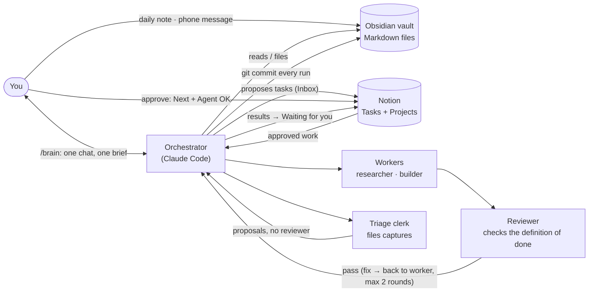

# System diagram

How the pieces talk to each other. GitHub and Obsidian render this Mermaid block as a picture.

**In words**
1. You write: a daily note in Obsidian, or a message to `/brain` from your phone.
2. `/brain` files it into the vault (ideas, projects, people, facts about you) and proposes Notion tasks with Status **Inbox**.
3. You approve in Notion: move a task to **Next** and tick **Agent OK**.
4. `/brain` hands approved work to a worker (researcher or builder). The reviewer checks every result against the task's definition of done before you see it.
5. Results go back to Notion as **Waiting** for your review, and you get one brief with everything waiting on you.
6. Every run is a git commit, so you can see and undo any change.
